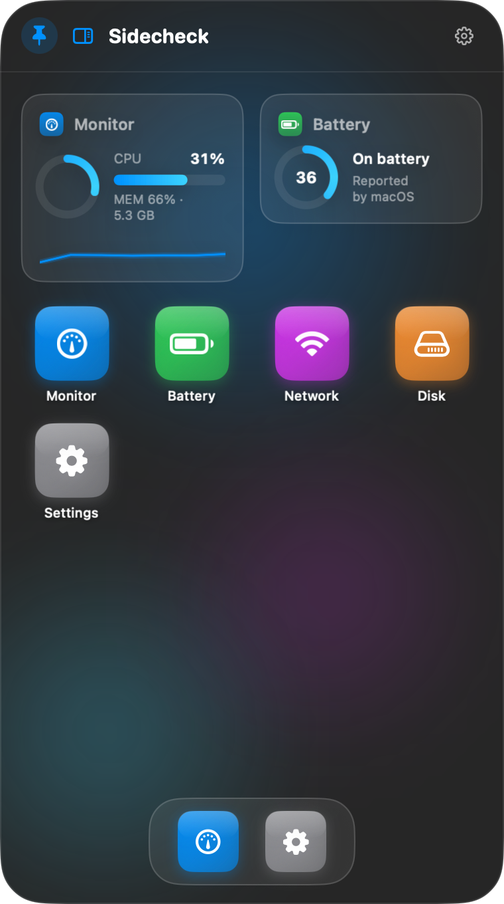
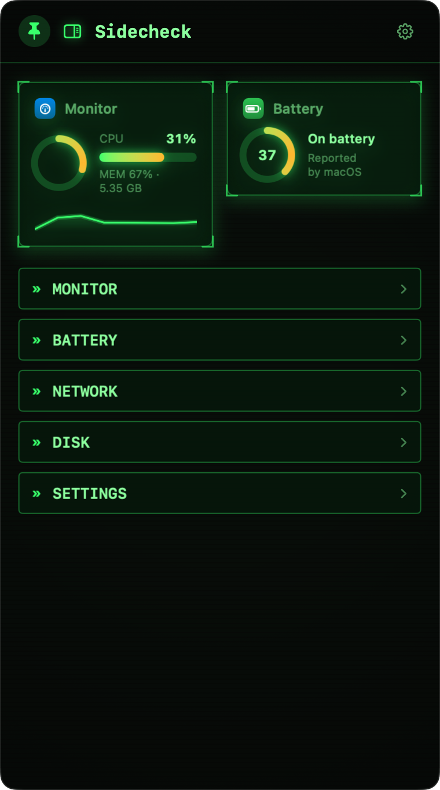

# Sidecheck

A tiny personal macOS menu-bar app: hover the pointer at the **middle-right edge** of any screen and a panel pops out — a full **app platform** with a tappable home screen, swappable widgets, and two themes.



## The app platform

The panel is a tiny launcher/OS:

- **Home screen** — 2–6 widget slots + an app grid (+ dock and search pill on themes that want them). Long-press anything → **edit mode**: rebind a widget slot to any app, reorder slots, remove them, hit Done.
- **Apps** — tap an icon to open the full app page:
  - **Monitor** — CPU ring + per-core bars + history + **live temperature (SMC)**, Memory, Battery, Network, Disk, GPU (model identity; utilization isn't exposed by public macOS APIs), uptime
  - **Clipboard** — everything you copy system-wide, captured automatically (strings/links, last 50), searchable, tap to re-copy; password fields (secure input) are never captured
  - **Awake** — keep the Mac awake via `/usr/bin/caffeinate`: 1h / 2h / 4h / ∞ or a custom duration, countdown ring + optional home widget, "keep display awake" toggle. Lid closure survives on **AC power** (macOS blocks clamshell on battery — the app warns); sessions stop when Sidecheck quits
  - **Wallpaper** — per-theme backgrounds: the theme's animated look, any other theme's animated style, solid colors, gradient presets (+ angle), **pictures and videos with a pan/zoom crop editor** (drag + pinch/slider) so oversized media can be positioned exactly; videos loop muted (sound toggle) and pause while the panel is hidden; "apply to all themes" for one look everywhere
  - **Settings** — everything below
  - **Tokens** — AI token usage from [tokscale](https://github.com/junhoyeo/tokscale): per-model/session/project breakdowns, **cache hit rate**, daily trend, cost estimates (secondary); scans run while the panel is open via the tokscale CLI (PATH → bunx → npx, with a TUI-cache fallback)
  - **Battery / Network / Disk** — focused detail views with big sparklines
- **Home widgets** — any app's compact widget can sit on the home screen, so the data you care about is visible the instant the panel opens. Bindings persist.

## Themes

Three themes on one theme-agnostic base — each theme picks its own **frame size**, **home template** (icon tiles / terminal list), **icon corner radius**, and decorations (dock, search pill, header clock):

| Theme | Frame | Look |
|---|---|---|
| **Liquid Glass** | 380×680 | dark vibrancy + rising glass bubbles |
| **Cyberdeck** | 380×680 | phosphor terminal, scanlines, `» TEXT MENU` home template |
| **Noir** | 380×680 | black & white serif glow, drifting light fields, widgets stacked full-width, status-only color (green/yellow/red) |

### Adding a theme

Everything a theme does is declared in its `ThemeSpec` — no view special-cases a concrete theme id.

**Required (compile errors guide you — all in `ThemeStore.swift`):**

1. Add the `ThemeID` enum case
2. `displayName` + `symbol` switches
3. Add a `static let` `ThemeSpec` — all fields, including `showsCornerBrackets` and `defaultBackground`
4. `ThemeID.spec` extension switch
5. `previewGradient` switch (settings swatch)

**Spec knobs to choose:** `frameSize` (width ≥ 500 unlocks 6 home slots), `homeStyle` (icon tiles / terminal list), `homeStyle` decorations (`showsDock`, `showsSearchPill`, `showsClockInHeader` — pill/clock are currently false on both themes and kept as levers), `iconCornerRadiusRatio`, `iconLabelIsWhite`, `glow` (phosphor glow, Cyberdeck-only by design), `isLight` (switches system appearance), accent + text-role colors, `defaultBackground` (out-of-box wallpaper kind), `showsCornerBrackets` (card decoration), `litCardEdges` (directional top-lit card rims instead of a flat stroke), `litPanelBorder` (lit gradient panel rim), `bootShimmer` (one CRT power-on sweep per panel open), `meterSegments` (phosphor-segment widget meters vs smooth capsules), `stacksWideWidgets` (every home slot renders full-width, stacked — unlocks all 6 slots), `typographicWidgets` (serif type-first widget variants), `monochromeTiles` (white-on-dark app tiles), `accentIsLight` (dark glyphs on accent fills).

**Automatic — no code needed:** settings theme grid, menu-bar Theme submenu (identified by rawValue, never by row index), persisted `themeID` restore, per-theme `wallpaperSpecs` decode, window frame morph on switch, `ThemeTemplateTests` (fails if the spec is incomplete).



## Customization (Settings app)

- **Panel size** — 75–125% scale of the theme frame, applied live
- **Open/close animation** — Slide (edge drawer) / Pop (fade + bouncy spring) / Zoom (grows from the edge), plus a speed slider (0.15–0.5 s)
- **Edge zone** — hot-zone width/height and show/hide dwell delays, live
- **Home widgets** — slot count (2–6) and reorder chevrons per slot
- **Alerts** — low-battery notifications at 20% and 10% (asks for notification permission once, on enable)
- **Appearance** — theme picker
- Reduce Motion is respected everywhere (fade-only entrance, static backgrounds, instant theme switch)

## Behavior & controls

- Hover the right-edge hot zone (middle 40% of screen height) → panel opens after a short dwell; move away → hides after a grace period. Works on every display.
- **Pin** keeps the panel open while you interact; keyboard focus in the panel (e.g. clipboard search) also holds it open.
- **Switching themes while the panel is open is a seamless morph**: the window animates to the new theme's exact frame (flush right, vertically centered) over the same 0.32 s curve the content crossfades — the panel visibly grows/shrinks between theme frame sizes with nothing re-anchoring it (`NSHostingView.sizingOptions = []` keeps the window the single sizing authority).
- Menu bar: Show panel · Enabled · Theme submenu · Launch at Login · Quit.
- Never steals keyboard focus; floats over fullscreen apps; no permissions needed (`NSEvent` monitors only). Notifications appear only if you enable low-battery alerts.

## Build & run

```bash
swift run                       # dev build, runs in place
./Scripts/make_app.sh           # release build → build/Sidecheck.app
open build/Sidecheck.app
cp -R build/Sidecheck.app /Applications/   # to install
```

## Architecture notes

- `Apps/PanelApp.swift` — `AppID` (monitor, clipboard, settings) + `WidgetKind` (home widget flavors; battery/network/disk widgets open Monitor); adding an app = one case + `fullView` branch
- `Apps/HomeStore.swift` — slot count + widget slots + edit mode, persisted (`homeSlotCount`, `homeWidgetSlots`)
- `Apps/HomeScreen.swift` — theme-driven home (widget slots, grid/terminal launcher, dock)
- `AwakeStore.swift` — /usr/bin/caffeinate child process (`-i -m -s [-d] [-t sec]`), stale-PID cleanup on launch, stops on quit
- `Apps/ScreenTimeStore.swift` — foreground-app usage tracker (NSWorkspace activations + 1 s heartbeat, CGEventSource idle pause, lock/sleep/fast-user-switch suspensions), per-day JSON in UserDefaults, 90-day retention; zero permissions
- `Apps/ScreenTimeAppView.swift` — Today/Week dashboard (Canvas bar chart, hour/day drill-down, Most Used with LaunchServices icons)
- `Apps/ClipboardStore.swift` — pasteboard change-count polling → 50-item history, persisted
- `Apps/WallpaperStore.swift` — per-theme `BackgroundSpec` persistence (`wallpaperSpecs`), image cache, looping AVPlayers. Kinds: bubbles/crt/glow/solid/gradient/picture/video (theme-native + blobs removed v0.9 — stale persisted kinds decode as bubbles; per-theme defaults via `defaultSpec(for:)`). The custom color picker orders `NSColorPanel` front directly with a target/action bridge + `NSApp.activate` — a well click in the non-activating panel never opens it otherwise; while open, the edge tracker vetoes auto-hide
- `Backgrounds.swift` — spec-driven `PanelBackgroundView` (bubbles / CRT / solid / gradient / picture / video), glass bubbles, gradient presets
- `Apps/AppViews.swift` — full app pages + IORegistry GPU name helper
- `ThemeStore.swift` — `ThemeSpec` design tokens incl. `frameSize`, `homeStyle`, `iconCornerRadiusRatio`
- `PanelController.swift` — NSPanel, size scale, animation presets, live re-frame, theme-switch morph, edge-zone tuning
- `SMC.swift` — read-only AppleSMC client (80-byte struct layout) for CPU temperature
- `BatteryAlerter.swift` — shared IOKit battery read + 30 s alerter timer + UN notifications
- `PerfStore.swift` — 1 Hz self-sampling (task_info + proc_pid_rusage + proc_pidinfo) feeding Settings → Diagnostics; `proc_pid_rusage`'s buffer is a plain void* — pass the struct's address directly
- `Widgets/StatsStore.swift` — 1 Hz CPU/memory/network + 5 s temperature + 15 s battery/disk/uptime sampling, 60-sample history
- `Widgets/ProcessStore.swift` — per-process CPU% + phys-footprint while the panel is visible; **CPU = sum of per-THREAD times** (`PROC_PIDTHREADINFO`) because task-level counters (`proc_pid_rusage`, `PROC_PIDTASKINFO`) are billing-clamped for other processes on modern macOS — a 98% burner reads as 2% through them
- `PerformanceStore.swift` — **feature registry** (`PerformanceFeature`: 8 switches — animated wallpapers, video playback, panel movement, micro-animations/glow, live tickers, fast stats polling, process scanning, fast music polling). Modes Pretty/Balanced/Saver map to feature sets (`performanceMode`); **Custom** = user-toggled set (`performanceCustom`); **Follow power** (`performanceAutoPower`) flips Saver↔Pretty with the plug. Cadence stores take a `featuresProvider` closure (wired in PanelController.init) — **that closure + one enum case is the integration template for future apps**. Estimates: `PerformanceStore.estimate(features:kind:)`. Measured: bubbles 10.4% → 1.9% CPU, 82 → 12 wakeups/s on Saver
- `Apps/MusicStore.swift` — Spotify/Music now-playing via osascript (MediaRemote info is entitlement-blocked since macOS 15.4); app-lifetime adaptive poll (3 s visible / 15 s hidden / skipped when no player runs), client-side position interpolation, per-track artwork cache
- `Apps/ListeningStats.swift` + `ListeningStore.swift` — provider protocol for listening stats; local history accumulates from every poll (background, persisted `"listeningHistory"`, flush throttled 30 s + on track change because SIGTERM skips `applicationWillTerminate`), favorites, "This Mac" provider. Per-listen caps are session-scoped and a position rewind (replay/scrub-back) starts a fresh listen, so looped tracks keep counting
- `Apps/StatsFmProvider.swift` — optional stats.fm backend (username + optional personal token, nothing hardcoded); public `streams/recent` + `top/*` endpoints, lowercase range values, TTL cache, ISO-fractional date decoding
- `Apps/TokscaleStore.swift` — shells out to [tokscale](https://github.com/junhoyeo/tokscale) (`models --json --group-by …` for sessions/projects/models, `graph --output` for the all-time daily trend); resolution chain PATH → bunx → npx → TUI-cache fallback; scans run on a background queue, gated to panel-visible; **per-range memoization (60 s TTL)** — range switches render the cached snapshot instantly and stale ones refresh behind the scenes (only the Rescan button forces); no persistence — tokscale owns the data
- Home screen slot count 1 = one full-width widget slot; Monitor/Battery/Screen Time/Tokens/Music have wide variants (`WidgetKind.wideWidget`). Noir (`stacksWideWidgets`) renders **every** slot as a stacked full-width card and unlocks all 6 slots. Classic themes render **hero cards**: the row claims up to ~30% of the frame (`HomeScreen.heroHeight`), each widget's visuals scale with it (`widgetScale` environment), and MeterBar renders per theme — smooth glass capsules vs Cyberdeck's segmented phosphor bars (`ThemeSpec.meterSegments`). Noir widgets are typographic serif (`typographicWidgets`): Monitor drops the ring for the big value, Battery is a type-first card, Screen Time lists the top 3 apps, Tokens leads with today's usage, Performance shows the impact estimate
- Panel settings persist: `themeID`, `panelScale`, `panelAnimationStyle`, `panelAnimationSpeed`, `homeSlotCount`, `homeWidgetSlots`, `wallpaperSpecs`, `hotZoneWidth`, `hotZoneSpan`, `showDwellDelay`, `hideDwellDelay`, `lowBatteryAlertsEnabled`, `clipboardItems`, `screenTimeDays`, `screenTimeEnabled`, `screenTimeIdleMinutes`, `awakeKeepsDisplay`, `awakePID`

## Dev/test hooks

```bash
SIDECHECK_AUTOSHOW=1 SIDECHECK_OPENAPP=settings .build/release/Sidecheck
```

`SIDECHECK_AUTOSHOW=1` pops (and pins) the panel 2 s after launch; `SIDECHECK_OPENAPP=<appId>` navigates to an app; `SIDECHECK_SETTHEME=<themeId>` live-switches the theme while open (for morph testing); `SIDECHECK_PERFLOG=1` prints one perf line to stderr every 5 s (CPU %, footprint, idle wakeups, syscalls, threads); `SIDECHECK_AWAKE=<seconds>` starts an Awake session at launch (0 = infinite); `SIDECHECK_SCREENTIME_SEED=<days>` fills Screen Time with deterministic synthetic history for chart verification; `SIDECHECK_SCREENTIME_LOG=1` logs tracker switches/flushes/idle pauses to stderr. Show/hide events log to stderr.

**Perf invariants** (visible in Settings → Diagnostics): while **hidden** the app should sit at ≈0% CPU and single-digit wakeups/s — animated backgrounds, including video wallpapers, pause once the hide animation finishes (they keep playing *through* the slide so nothing freezes mid-motion); all animations run at 30 fps. Stats sample at 0.5 Hz — at 1 Hz every widget text change re-armed a display-rate AppKit layout pass (~20% CPU). Solid colors and gradients are nearly free; bubbles/CRT ~8%; a playing video wallpaper ~20% by design.

## Roadmap

- [ ] More apps (top processes, now-playing, quick launch)
- [ ] Multi-page home + drag-to-rearrange icons
- [x] Noir — B&W serif glow theme with stacked widgets
- [ ] More themes (the Vita bubble look may return as a template)
- [ ] Global hotkey to toggle the panel

---
*v0.15.0 — **Noir**, the third theme: black & white with a serif glow, status-only color (green charging / yellow hot / red critical), a drifting light-field background (`glow` kind), monochrome app tiles, and home widgets stacked full-width (2–6 of them). The home header trades the wordmark for a centered live clock. Music's wide widget trades its play badge for an animated equalizer, the Music app drops the player tag, Tokens' long widget tightens to usage + cache hit, and the Wallpaper/Disk/Settings home widgets are removed. Plus the polish: typographic widgets, memory visualizer fixes, Tokens per-range caching. Still built by an agent and its human.* ⚡Still built by an agent and its human.* ⚡
