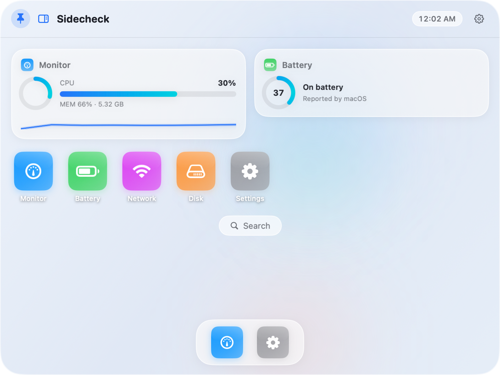

# Sidecheck

A tiny personal macOS menu-bar app: hover the pointer at the **middle-right edge** of any screen and a panel pops out — a full **app platform** with an iPadOS-style home screen, tappable apps, swappable widgets, and three themes.



## The app platform

The panel is a tiny launcher/OS:

- **Home screen** — 2–6 widget slots + an app grid (+ dock and search pill on themes that want them). Long-press anything → **edit mode** (jiggle): rebind a widget slot to any app, reorder slots, remove them, hit Done.
- **Apps** — tap an icon to open the full app page:
  - **Monitor** — CPU ring + per-core bars + history + **live temperature (SMC)**, Memory, Battery, Network, Disk, GPU (model identity; utilization isn't exposed by public macOS APIs), uptime
  - **Clipboard** — everything you copy system-wide, captured automatically (strings/links, last 50), searchable, tap to re-copy
  - **Wallpaper** — per-theme backgrounds: the theme's animated look, any other theme's animated style, solid colors, gradient presets (+ angle), **pictures and videos with a pan/zoom crop editor** (drag + pinch/slider) so oversized media can be positioned exactly; videos loop muted (sound toggle) and pause while the panel is hidden; "apply to all themes" for one look everywhere
  - **Settings** — everything below
  - **Battery / Network / Disk** — focused detail views with big sparklines
- **Home widgets** — any app's compact widget can sit on the home screen, so the data you care about is visible the instant the panel opens. Bindings persist.

## Themes

Three themes on one theme-agnostic base — each theme picks its own **frame size**, **home template** (icon tiles / terminal list), **icon corner radius**, and decorations (dock, search pill, header clock):

| Theme | Frame | Look |
|---|---|---|
| **Liquid Glass** | 380×680 | dark vibrancy + rising glass bubbles |
| **iPad** | **720×540 (4:3 landscape)** | light wallpaper, squircle icon grid, dock, clock |
| **Cyberdeck** | 380×680 | phosphor terminal, scanlines, `» TEXT MENU` home template |


## Customization (Settings app)

- **Panel size** — 75–125% scale of the theme frame, applied live
- **Open/close animation** — Slide (edge drawer) / Pop (fade + bouncy spring) / Zoom (grows from the edge), plus a speed slider (0.15–0.5 s)
- **Edge zone** — hot-zone width/height and show/hide dwell delays, live
- **Home widgets** — slot count (2–6) and reorder chevrons per slot
- **Alerts** — low-battery notifications at 20% and 10% (asks for notification permission once, on enable)
- **Appearance** — theme picker
- Reduce Motion is respected everywhere (fade-only entrance, static backgrounds, no jiggle, instant theme switch)

## Behavior & controls

- Hover the right-edge hot zone (middle 40% of screen height) → panel opens after a short dwell; move away → hides after a grace period. Works on every display.
- **Pin** keeps the panel open while you interact; keyboard focus in the panel (e.g. clipboard search) also holds it open.
- **Switching themes while the panel is open is a seamless morph**: the window animates to the new theme's exact frame (flush right, vertically centered) over the same 0.32 s curve the content crossfades — the panel visibly grows/shrinks between phone-card and iPad shapes with nothing re-anchoring it (`NSHostingView.sizingOptions = []` keeps the window the single sizing authority).
- Menu bar: Show panel · Enabled · Theme submenu · Launch at Login · Quit.
- Never steals keyboard focus; floats over fullscreen apps; no permissions needed (`NSEvent` monitors only). Notifications appear only if you enable low-battery alerts.

## Build & run

```bash
swift run                       # dev build, runs in place
./Scripts/make_app.sh           # release build → build/Sidecheck.app
open build/Sidecheck.app
cp -R build/Sidecheck.app /Applications/   # to install
```

## Architecture notes

- `Apps/PanelApp.swift` — `AppID` (monitor, clipboard, settings) + `WidgetKind` (home widget flavors; battery/network/disk widgets open Monitor); adding an app = one case + `fullView` branch
- `Apps/HomeStore.swift` — slot count + widget slots + edit mode, persisted (`homeSlotCount`, `homeWidgetSlots`)
- `Apps/HomeScreen.swift` — theme-driven home (widget slots, grid/terminal launcher, dock)
- `Apps/ClipboardStore.swift` — pasteboard change-count polling → 50-item history, persisted
- `Apps/WallpaperStore.swift` — per-theme `BackgroundSpec` persistence (`wallpaperSpecs`), image cache, looping AVPlayers
- `Backgrounds.swift` — spec-driven `PanelBackgroundView` (theme / bubbles / blobs / CRT / solid / gradient / picture / video), glass bubbles, gradient presets
- `Apps/AppViews.swift` — full app pages + IORegistry GPU name helper
- `ThemeStore.swift` — `ThemeSpec` design tokens incl. `frameSize`, `homeStyle`, `iconCornerRadiusRatio`
- `PanelController.swift` — NSPanel, size scale, animation presets, live re-frame, theme-switch morph, edge-zone tuning
- `SMC.swift` — read-only AppleSMC client (80-byte struct layout) for CPU temperature
- `BatteryAlerter.swift` — shared IOKit battery read + 30 s alerter timer + UN notifications
- `PerfStore.swift` — 1 Hz self-sampling (task_info + proc_pid_rusage + proc_pidinfo) feeding Settings → Diagnostics; `proc_pid_rusage`'s buffer is a plain void* — pass the struct's address directly
- `Widgets/StatsStore.swift` — 1 Hz CPU/memory/network + 5 s temperature + 15 s battery/disk/uptime sampling, 60-sample history
- Panel settings persist: `themeID`, `panelScale`, `panelAnimationStyle`, `panelAnimationSpeed`, `homeSlotCount`, `homeWidgetSlots`, `wallpaperSpecs`, `hotZoneWidth`, `hotZoneSpan`, `showDwellDelay`, `hideDwellDelay`, `lowBatteryAlertsEnabled`, `clipboardItems`

## Dev/test hooks

```bash
SIDECHECK_AUTOSHOW=1 SIDECHECK_OPENAPP=settings .build/release/Sidecheck
```

`SIDECHECK_AUTOSHOW=1` pops (and pins) the panel 2 s after launch; `SIDECHECK_OPENAPP=<appId>` navigates to an app; `SIDECHECK_SETTHEME=<themeId>` live-switches the theme while open (for morph testing); `SIDECHECK_PERFLOG=1` prints one perf line to stderr every 5 s (CPU %, footprint, idle wakeups, syscalls, threads). Show/hide events log to stderr.

**Perf invariants** (visible in Settings → Diagnostics): while **hidden** the app should sit at ≈0% CPU and single-digit wakeups/s — animated backgrounds, including video wallpapers, pause whenever the window isn't visible; all animations run at 30 fps. Visible-idle with an animated theme (bubbles/blobs/CRT) is ~7% CPU and a playing video wallpaper ~20% by design; solid colors and gradients are nearly free.

## Roadmap

- [ ] More apps (top processes, now-playing, quick launch)
- [ ] Multi-page home + drag-to-rearrange icons
- [ ] More themes (the Vita bubble look may return as a template)
- [ ] Global hotkey to toggle the panel

---
*v0.5 — wallpaper app (animated / solid / gradients / pictures / videos with pan-zoom crop), glass bubbles, permission checker. Still built by an agent and its human.* 🎨
